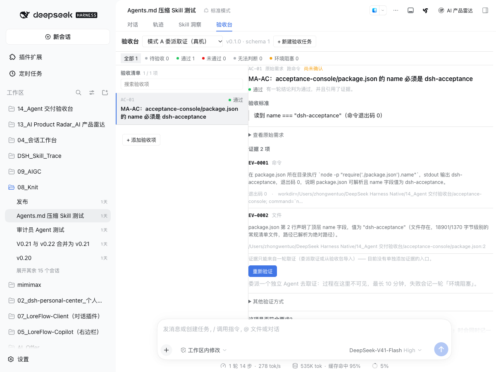
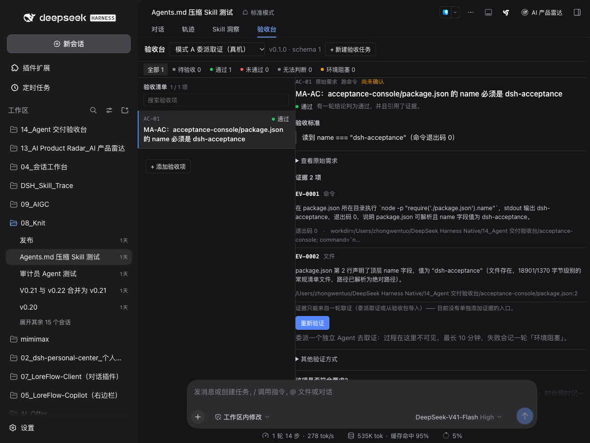
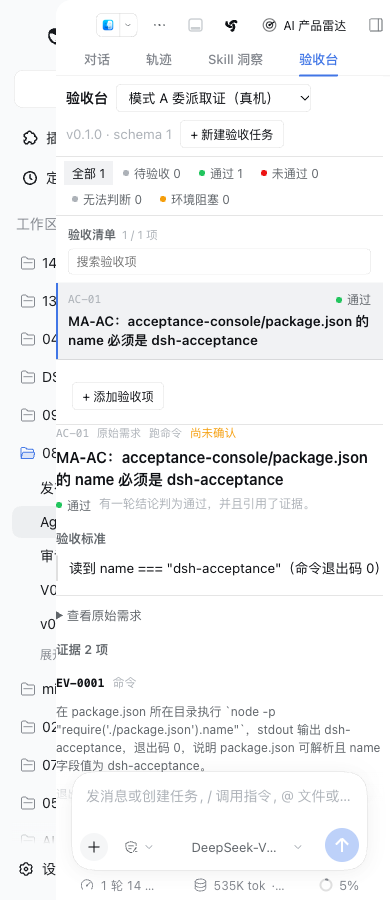

# dsh-acceptance · Agent 交付验收台

把 AI Coding 的交付验收做成**任务级的凭证工作台**：管理任务契约、验收项、执行证据、返修轮次与用户的最终决定。

它**不是**代码审查器，**不是**全自动测试平台。产品唯一的资产是**结论可信** —— 任何提高自动化程度却降低结论可信度的做法，一律不做。

> 当前版本 `0.2.0` · 契约 `schemaVersion = 1` · 100 项行为断言 · 24 条守卫 · 与 DSH 0.2.x 桌面端配套（0.2.1-alpha.2 起）



它是 DeepSeek Harness（DSH）的一个 `conversation.view` 全页面插件：装好之后，对话上方多一个**「验收台」**页签。

## 它保证什么

这八条不是文案，是**会红的守卫**（`npm run verify` 的 G1–G11）加 100 项行为断言：

1. **不做汇总评分。** 凭证与导出里不存在 `score` / `passRate` / `completion`，也不折算成比率 —— 五态并列呈现。（G2、G3）
2. **没有证据就不是通过。** 无证据 = `无法判断`（`unknown`），**不自动判失败**；未发现问题 ≠ 通过。（G5、`.import` 与委派两条路同规矩）
3. **每条证据必须可寻址。** 定位不到的东西不算证据 —— **写入时**即被拒绝并报错，不降级成空 locator。（G5）
4. **原始需求与建议补充分列。** 凭证里 `origin` 必须区分 `original` / `suggested`。（导出与验收包分列）
5. **判定权在宿主。** 客户端只渲染、只提交操作；状态派生、证据合法性全在宿主的纯函数域里。（G7）
6. **验收项 id 单调递增，永不复用已删除的 id。**（G8）
7. **不做版本指纹的替代品。** 拿不到快照就写「版本未知」，**禁止**用变更文件列表派生哈希冒充指纹。（G3）
8. **不把「读不到变更范围」说成「没有改动」。** 空列表至少三种成因，界面与导出必须是三句不同的话。

## 五态

| 键 | 界面显示 | 含义 |
|---|---|---|
| `pending` | 待验收 | 还没验，或验了没给结论 |
| `pass` | 通过 | 有本轮证据支撑的通过 |
| `fail` | 未通过 | 有证据证明不符合 |
| `unknown` | 无法判断 | 证据不足以判断 —— **不是通过** |
| `blocked` | 环境阻塞 | 环境/依赖挡住了取证，不是代码问题 |

「证据采集状态 / 验收项判断 / 任务最终决策」是三件事，不许混成一种。

## 安装

插件是**本地 `link:` 包**，要动三处 —— 缺一处都会**静默跳过**（表现为页签不出现、路由 404）：

```jsonc
// ~/.dsh/profiles/<当前 profile>/package.json
"dependencies": {
  "dsh-acceptance": "link:/绝对路径/到/acceptance-console"
},
"dsh": { "profile": { "bundles": [ /* … */ "dsh-acceptance" ] } }
```

```bash
cd ~/.dsh/profiles/<当前 profile>
ln -sfn "/绝对路径/到/acceptance-console" node_modules/dsh-acceptance
```

> **<当前 profile> 是哪个？** DSH 的 profile 名会随版本变（0.2.1-alpha.2 的桌面端用 `desktop`，更早的版本用 `tauri`）。
> 看正在跑的那个进程：`ps -Ao command= | grep -E "dsh-desktop-host|dsh web"` —— 参数里出现的目录就是当前 profile。

装完**重启 App** 才生效（新的 bundle 不会热加载）。验证：

```bash
curl -s "http://127.0.0.1:<端口>/api/acceptance.health?sessionId=probe"
```

## 第一次使用

界面上写的就是下面这套文案，照着走一遍就是一次最小的真实验收。全程不需要先学「模式 A/B」或 schema。

1. **开始** —— 打开「验收台」。没有任务时首页是「**开始一次交付验收**」：
   > 把本次开发需求列成检查项，再根据证据决定是否接受交付。

   三步是：`写下需求 → 确认验收项 → 查看证据并作出决定`。
   点「**查看示例**」只会展开一段静态说明（**示例，不会写入凭证也不会创建任务**）。
   已经有任务、只是没选中时，页面说的是「选择一个任务继续」—— 这两句不是同一件事。

2. **写下需求** —— 点「**新建验收任务**」，粘贴你最初交给开发 Agent 的需求：
   - 任务名：`这次开发做了什么？`（可选）
   - 原始需求：`把你最初交给开发 Agent 的需求粘贴到这里`
   - 辅助提示：`保留原始表述。后续会把每条验收项和这份需求对应起来。`
   - 按钮：`创建并设置验收项`

   创建成功后会自动选中这个任务，并把你带到验收项区域。**创建失败会显示宿主的真实错误**，不会先报成功再异步失败。

3. **确认验收项** —— 逐条添加，每条写清「标题 + 通过条件」：
   - 标题示例：`健康检查接口返回 HTTP 200`
   - 通过条件示例：`请求成功，响应中包含 status 字段，且值为 ok`
   - 反例提示：`「功能正常」「体验不错」太宽泛，最好补充可观察的结果。`
   - 没写通过条件**不拦你**，只提醒：`还没有写清楚什么结果算通过。你仍可以继续，但判断时需要更谨慎。`
   - 确认动作叫「**确认验收标准**」。没有你确认的验收项，插件不会替你补。

   想省点打字：点「**复制验收项整理提示词**」，把那段文字贴进当前 DSH 对话或别的模型。
   它**只是可复制的文字 —— 插件不调用模型，也不会自动生成验收项**。

4. **拿到证据** —— 两种做法，主流程只用第一种的名字：
   - **让独立 Agent 帮我验证**（内部：模式 A）：`由 DSH 委派独立 Agent 检查已确认的验收项，并返回结构化证据。`
     验证过程可能不可见，最长等待时间以当前实现为准。缺会话 ID、或还没有确认的验收项时，
     按钮会在**点击前**写明原因和替代路径。
   - **我已经有检查结果**（内部：模式 B）：展开后才是生成验收包 → 在外部完成检查 → 把 JSON 结果贴回来。

   没有证据就不会有「通过」；委派失败会记一轮「环境阻塞」，**不会**记成未通过。

5. **看结果和下一步** —— 逐项看状态、观察结果和证据定位。底部决定栏会给一句与当前结果匹配的指引（只显示一处，不重复占地方）：
   - 全都没证据：`先开始验证，当前还没有可供判断的证据。`
   - 还有 `pending`：`还有验收项没有结论。`
   - 有 `unknown`：`证据还不足以判断。请补充验证或人工核对。`
   - 有 `blocked`：`验证受到环境或依赖阻碍。先解决阻碍，再重新验证。`
   - 有 `fail`：`发现不符合要求的项目。可以生成修复说明并交回开发 Agent。`
   - 全部 `pass`：`每一项都有通过结论。请核对记录后作出最终决定。`

6. **修复或决定** —— 「**生成修复说明**」把未通过、尚未确定和被环境阻塞的事项**分四类**列出来（不统称「失败」），交给开发 Agent；
   「**导出验收记录**」导出的是当前凭证，**不会触发新的验证**。
   最后按含义选一个：`接受交付` / `要求修复` / `暂缓验收`。
   **只要还有一项不是「通过」，「接受交付」就点不动**，并会把剩下的项逐条写出来；全部通过后仍由你显式确认。

> **版本未知是事实，不是 bug。** 取不到可靠快照时界面写「版本未知」，并解释：
> `当前没有取得可靠的代码版本快照，因此本次凭证无法确认绑定到哪个代码版本。`
> 插件不会用文件列表或时间戳编一个假指纹。

## 常用命令

```bash
npm test                        # 100 项行为断言（pretest 会先重建客户端产物）
npm run verify                  # 守卫 G1–G11，11/11 才算过
npm run build:client            # 重建 dist/client.js（浏览器跑的是它，不是源码）
```

三条最容易白干的纪律：

1. 浏览器跑的是 `dist/client.js`，**不是源码**。改完客户端必须重建；`dist/` 是提交进仓库的发布产物（G6 会检查 stamp 是否过期）。
2. **宿主半改了必须重启 DSH。** 代码进内存后不会自动换，而且旧代码**答得很正常、不报错**。
3. 客户端里的 CSS 是模板字符串，**里面禁止出现反引号** —— 写一个就提前结束字符串。改完先 `node --check src/dsh/client/client.js`。

## 目录

```
acceptance-console/
├── package.json              ← dsh.bundle.patch + dsh.client.{platform,inject}
├── cordis.patch.yml          ← - insert: [{ id: dsh-acceptance, name: dsh-acceptance }]
├── src/dsh/host/index.js     ← apply(ctx, config) + 9 条路由 + 会话上下文读取
├── src/dsh/host/domain.js    ← 纯函数域：派生状态、校验、id 分配、导出与验收包（所有判定都在这儿）
├── src/dsh/host/store.js     ← 凭证存储（原子写；读不出来的文件计入 broken，不静默丢弃）
├── src/dsh/client/client.js  ← 单文件 CommonJS + React（只渲染，不判定）
├── scripts/build-client.mjs  ← 打包 + external 漂移检查 + 源码哈希 stamp
├── scripts/verify-project.mjs← 守卫 G1–G11
├── test/                     ← gate（域逻辑）/ host（路由与状态码）/ client-bundle（真跑产物）
├── design/tokens.css         ← UI 设计 Token 快照（真源是跨项目 skill dsh-plugin-ui）
├── assets/                   ← README 用图
└── dist/client.js            ← 发布产物（提交进仓库）
```

## 两种写入模式

| | 模式 A：委派取证 | 模式 B：验收包导入 |
|---|---|---|
| 谁执行 | 宿主调 `ctx.subagents.start()`，传 `outputSchema` 钉死验收项 id | 在外部完成取证，把结构化结果原样贴回来 |
| 失败处置 | **承诺点**之前失败 ⇒ 4xx 且不写轮次；之后失败 ⇒ 写一轮 `blocked`（HTTP 仍 200） | 任意一条不合格 ⇒ 整轮拒收，一条证据也不落 |
| 共同点 | 证据与结论同批落库；**无证据的通过一律拒收** | 同左 |

两种模式产出的轮次逐字段相同 —— 模式 B 是保底通道，不是降低结论标准的通道。




## 不做

- 不做汇总分数、进度条、通过率、健康度。
- 不重造 DSH 生态里已有的东西（测试执行、代码审查、任务看板、人工签收）—— 只**导入**它们的证据。
- 不解析委派回来的自由文本：`structured` 缺失时，那段文字写得再确定也记 `blocked`。
- 不伪造版本指纹：拿不到就写 `null` = 「版本未知」。

## 许可

[MIT](LICENSE)
